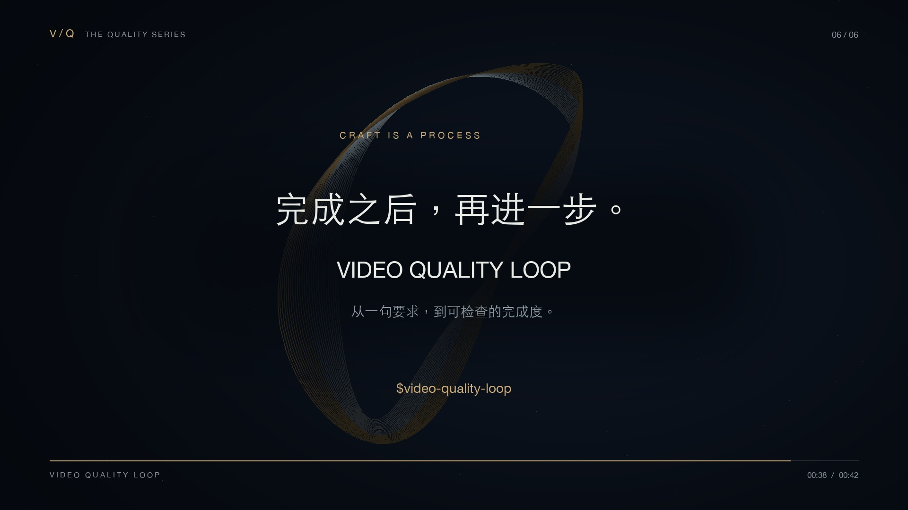

<div align="center">

# Video Quality Loop

### 每一帧，都值得再看一遍。

面向真实成片的视频质量闭环 Skill

**设定标准 → 检查成片 → 定点修复 → 重新渲染复验**

[观看介绍短片](https://github.com/2023Anita/video-quality-loop/blob/main/media/video-quality-loop-cinematic.mp4) · [阅读 Skill](video-quality-loop/SKILL.md) · [安装与使用](#安装与使用)

[](https://github.com/2023Anita/video-quality-loop/blob/main/media/video-quality-loop-cinematic.mp4)

42 秒 · 1920×1080 · 24fps · 中文合成旁白 · 原创程序合成配乐

</div>

## 让“高级”，有据可查

Video Quality Loop 将高完成度的创作目标拆成可观察、可记录、可复验的检查项。它帮助 AI 在视频制作与改版中，围绕真实导出的画面和声音发现问题、记录时间码、定点修改，再检查最新版本。

适用于宣传片、知识视频、产品演示和动态图形。不绑定特定视频引擎，需要配合当前环境可用的制作、渲染与检查工具使用。

## 十二个检查维度

| 内容与视觉 | 时间与声音 | 交付与一致性 |
| --- | --- | --- |
| 叙事与信息 | 运动与连续性 | 平台与画幅适配 |
| 字体与字幕 | 剪辑与节奏 | 原创性与一致性 |
| 留白与构图 | 微动效与细节 | 导出与完整性 |
| 视觉层级 | 声音 | 色彩与光影 |

每项记录为“通过 / 待修复 / 未验证 / 不适用”。实际不能检查的内容保留“未验证”，不以总分或宣传措辞代替验收。

## 如何工作

1. 明确受众、核心信息、平台、时长、画幅和交付约束。
2. 设计分镜、时间线及统一的视听风格。
3. 制作并渲染可检查的预览或成片。
4. 对实际成片记录“时间码 → 问题 → 影响 → 最小修复”。
5. 修改后重新渲染并复验，交付视频及检查说明。

默认最多三轮修复—复验，用户指定预算时遵守其预算。质量目标不会扩大付费、上传或发布的权限，也不会自动调用子代理。“获奖级”是创作方向，不是认证或效果保证。

## 安装与使用

将仓库内完整的 [`video-quality-loop/`](video-quality-loop/) 文件夹复制到 `~/.codex/skills/`。配置了 `CODEX_HOME` 时，放入其下的 `skills/`。保留目录结构，在新聊天中调用：

```text
使用 $video-quality-loop 制作一个介绍我产品的视频。
受众：第一次接触产品的创作者
平台与画幅：横屏 16:9
时长：约 40 秒
风格：电影感、暗色、克制的动态排版
交付：MP4 和源文件
```

已有视频也可以使用：

```text
使用 $video-quality-loop 检查并优化这个视频。
保留原有内容和品牌风格，先找出影响观看体验的问题，
记录时间码，修复后重新渲染复验，并说明未验证的部分。
```

## 介绍短片

《每一帧，都值得再看一遍》以银白、暖金光环与动态排版，介绍“目标—检查—修复—复验”的工作方式。画面是原创程序动态图形，检查窗口为概念演示，非真实软件录屏。

- [播放 / 下载 MP4](media/video-quality-loop-cinematic.mp4)
- [查看实际成片关键帧](media/final-frames.jpg)
- [分镜与制作说明](film/制作说明.md)
- [检查范围与限制](film/验收记录.md)
- [渲染源代码](film/render.py)

本片已完成一轮视觉修复、六个最终关键帧检查和全片技术解码。连续观看与实际听审尚未完成，不能据此宣称全部质量维度通过。

## 文件结构

```text
video-quality-loop/      可独立安装的 Skill
  SKILL.md
  agents/openai.yaml
media/                   介绍视频、封面与实际解码关键帧
film/                    渲染源码、分镜说明与验收记录
```

安装 Skill 只需复制对应文件夹，无需下载视频或配置渲染环境。演示片复现依赖 macOS 字体与系统语音、Pillow、NumPy 和 FFmpeg，详见制作说明。
